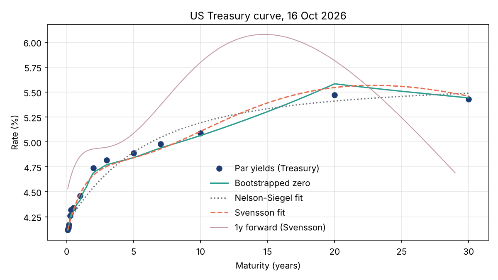

# fixed-income-analytics

A small Python library for pricing bonds and building yield curves, written from scratch with NumPy and SciPy. It covers the pieces you need to go from a screen of Treasury par yields to a zero curve, a smooth parametric fit, and risk numbers for a bond.



## What's in it

| Module | What it does |
| --- | --- |
| `daycount` | ACT/360, ACT/365F, 30/360 US, ACT/ACT ISDA and ACT/ACT ICMA year fractions |
| `schedule` | Coupon dates generated backwards from maturity, with the end-of-month rule |
| `bond` | `FixedRateBond`: clean/dirty price, accrued interest, yield to maturity, Macaulay and modified duration, convexity, DV01 |
| `curve` | `ZeroCurve`: discount factors, zero and forward rates, par yields, parallel shifts. Log-linear (flat forward) or linear interpolation |
| `bootstrap` | Zero curve from Treasury par yields (bills by simple interest, coupon tenors from the par bond condition) |
| `nss` | Nelson-Siegel and Svensson models with a grid search plus bounded least squares fit |
| `curve_risk` | Pricing off a curve, z-spread, key rate durations |
| `data.treasury` | Downloader and parser for the Treasury daily par yield curve CSV |

## Quick start

```bash
git clone https://github.com/YDawoud7/fixed-income-analytics
cd fixed-income-analytics
python -m venv .venv && source .venv/bin/activate
pip install -e ".[dev,plot]"
pytest -q
python examples/treasury_curve.py            # downloads the latest curve
python examples/treasury_curve.py --csv examples/sample_par_curve.csv   # offline
```

```python
from datetime import date
from fixedincome import FixedRateBond, bootstrap_par_curve, key_rate_durations

note = FixedRateBond(coupon=0.0425, maturity=date(2035, 11, 15))
settle = date(2026, 10, 19)
price = note.clean_price(0.0509, settle)
note.yield_to_maturity(price, settle)        # 0.0509
note.modified_duration(0.0509, settle), note.dv01(0.0509, settle)

tenors = [1/12, 3/12, 6/12, 1, 2, 3, 5, 7, 10, 20, 30]
pars   = [0.0412, 0.0426, 0.0434, 0.0446, 0.0474, 0.0482, 0.0489, 0.0498, 0.0509, 0.0547, 0.0543]
curve = bootstrap_par_curve(tenors, pars)
key_rate_durations(note, curve, settle)
```

## Example output (16 Oct 2026 Treasury curve)

```
Nelson-Siegel: b0=0.0565 b1=-0.0148 b2=0.0000 tau=3.21  rmse=8.80bp
Svensson:      b0=0.0000 b1=0.0407 b2=0.0425 b3=0.1648 tau1=1.98 tau2=15.55  rmse=3.04bp

10y note 5.125% at 5.090%: clean 100.2717
  modified duration 7.753, convexity 73.06, DV01 0.0777
  z-spread to bootstrapped curve: -0.41bp
  key rate durations: 0.5y 0.012, 1y 0.042, 2y 0.093, 3y 0.217, 5y 0.399, 7y 0.648, 10y 6.527, 20y 0.005
```

## Conventions and design choices

* **Street convention pricing.** Cash flows are discounted at `(1 + y/f)^(w + k)` where `w` is the fraction of the current coupon period left. This is how Treasury yields are quoted, so `yield_to_maturity` matches screen yields.
* **Bootstrapping.** Treasury CMT yields are par yields on a semiannual basis. Tenors under six months are treated as bills with simple interest. Par yields are linearly interpolated to a semiannual grid and each discount factor is solved from `1 = (c/2) * sum(DF_i) + (1 + c/2) * DF_n`, so the curve reprices every grid par bond exactly (this is tested).
* **Interpolation.** The default is linear in log discount factors, which gives piecewise flat forwards and avoids the oscillations of spline methods. The trade-off is that forwards from the bootstrapped curve jump at the pillars, which is why the chart shows forwards from the Svensson fit.
* **Fitting NSS.** For fixed decay parameters the model is linear in the betas, so the fit scans a grid of taus with OLS and then refines everything with `scipy.optimize.least_squares`. The level `b0` is kept non-negative and Svensson's second decay is kept at least 1.5x the first. Without that, the two hump terms become nearly collinear and `b2`, `b3` explode in opposite directions for almost no gain in fit.
* **Key rate durations.** Triangular zero rate bumps that peak at each key tenor and fade to zero at its neighbours. They add up to a parallel shift, so the key rate durations sum to the curve duration (also tested).

## Things I noticed

* On the 16 Oct 2026 curve the 20y par yield (5.47%) sits above the 30y (5.43%). Nelson-Siegel can't produce that shape, so its fit error is about 9bp. Svensson gets it down to 3bp by using its long hump (`tau2` around 15y) to absorb the kink, but then the long-run level `b0` hits its lower bound. With nothing past 30y in the data, the asymptote is poorly identified once the hump explains the long end. So the Svensson betas shouldn't be read as "level, slope, curvature" the way the Nelson-Siegel ones can.
* Linear interpolation of par yields between 10y and 20y creates a visible kink in bootstrapped forwards. Interpolating on a smoother basis (or fitting first and bootstrapping off the fit) would fix it, at the cost of not repricing the inputs exactly.

## Tests

61 tests cover textbook reference values (the Fabozzi 20-year 10% bond at 11% prices at $919.77 per $1,000 face, and a 5-year 9% par bond has a Macaulay duration of 4.13 years), analytic versus finite difference duration and convexity, yield round trips, schedule edge cases (month end, leap years), bootstrap repricing, NSS parameter recovery and key rate additivity.

## Limitations

* Fixed-rate bullet bonds only. No callables, floaters or inflation-linked bonds.
* No holiday calendars: coupon dates are unadjusted, which matches Treasury accrual but not every market.
* The last coupon period uses the same compounding as the others rather than the money market convention some markets apply.

## Data

Par yields come from the U.S. Department of the Treasury's [Daily Treasury Par Yield Curve Rates](https://home.treasury.gov/resource-center/data-chart-center/interest-rates/TextView?type=daily_treasury_yield_curve). `examples/sample_par_curve.csv` is a three-day extract from that source for offline use.
